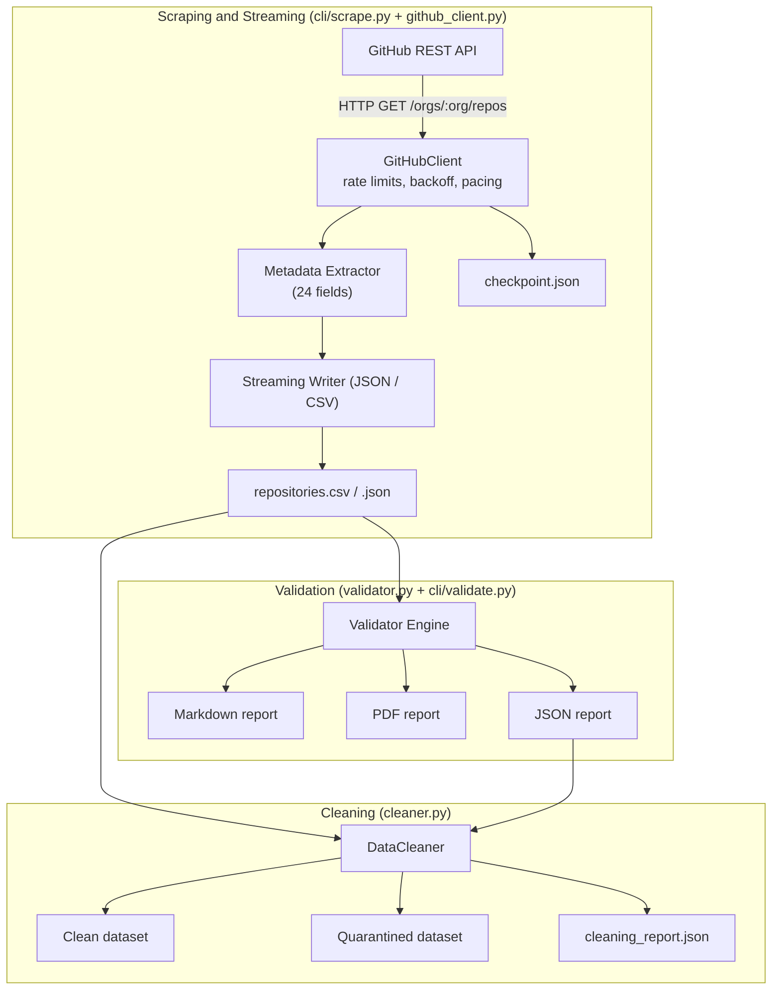
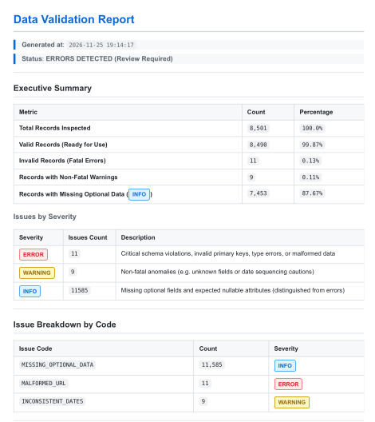

# GitHub Repo Data Pipeline

[](https://github.com/sihela/github-org-repo-pipeline/actions/workflows/ci.yml)


A resilient, low-memory data pipeline that **scrapes** repository metadata from the GitHub REST API, **validates** it with a configurable standalone engine, and **cleans** it based on the validator's machine-readable report.

Built to run comfortably on modest hardware (8 GB RAM, dual-core CPU) by streaming data to disk instead of holding it in memory.

---

## Features

- **Polite, resilient scraping**
  - RFC 5988 pagination
  - Handles HTTP 429 and secondary rate limits (HTTP 403), including `Retry-After` parsing
  - Full-jitter exponential backoff and configurable delay between pages
- **Checkpoint and resume**: atomic per-page checkpoints; `--resume` continues an interrupted run without duplicating rows or headers
- **O(1) memory streaming**: JSON and CSV output are written incrementally
- **Standalone validator**: configurable checks, type validation, URL checks, duplicate primary-key detection, custom hooks, and per-field rules
- **Three-report contract**: every validation run produces a Markdown, PDF and JSON report
- **Decoupled cleaner**: consumes the validator's JSON report, repairs fixable fields, deduplicates, and quarantines invalid records
- **Unicode-safe**: preserves accents, CJK characters, emoji, math symbols and HTML/quotes end to end
- **Well tested**: 40 unit tests, with mocked network calls and no external requests

---

## Architecture



### Design principles

1. **Complete decoupling.** The validator knows nothing about the cleaner. It emits a standard JSON report that any cleaner can consume, so cleaning logic can change per project without touching validation.
2. **Three-report contract.** One Markdown, one PDF and one JSON report per run, for humans and downstream tools alike.
3. **Low-memory streaming.** Output is flushed progressively rather than accumulating thousands of dicts in memory.
4. **Resilience and politeness.** Backoff, jitter, pacing and checkpoints so long scrapes survive rate limits and interruptions.

---

## Project structure

```
github-repo-data-pipeline/
├── src/repo_pipeline/
│   ├── __init__.py
│   ├── github_client.py
│   ├── extractor.py
│   ├── validator.py
│   ├── cleaner.py
│   ├── sample_data.py
│   └── cli/
│       ├── scrape.py
│       └── validate.py
├── tests/
├── docs/
│   └── architecture.md
├── .github/workflows/ci.yml
├── .gitignore
├── LICENSE
├── README.md
├── pyproject.toml
└── requirements.txt
```

| Path | Role |
| :--- | :--- |
| `src/repo_pipeline/github_client.py` | GitHub API client: pagination, rate limits, retries, pacing |
| `src/repo_pipeline/extractor.py` | Normalizes raw API JSON into 24 uniform fields |
| `src/repo_pipeline/cli/scrape.py` | Scraper CLI with streaming output, checkpoints and `--resume` |
| `src/repo_pipeline/validator.py` | Standalone validation engine and report generation |
| `src/repo_pipeline/cli/validate.py` | Validation CLI (toggle checks, override field requirements) |
| `src/repo_pipeline/cleaner.py` | Report-driven repair, deduplication and quarantine |
| `src/repo_pipeline/sample_data.py` | Deliberately corrupted dataset and default validation config |
| `tests/` | Unit test suite |
| `docs/architecture.md` | Detailed architecture notes and design principles |

---

## Installation

```bash
git clone https://github.com/sihela/github-org-repo-pipeline.git
cd github-org-repo-pipeline

python -m venv .venv
source .venv/bin/activate        # Windows: .venv\Scripts\activate

pip install -e .
```

**Optional: PDF reports.** PDF generation uses Playwright:

```bash
pip install -e ".[pdf]"
playwright install chromium
```

---

## Usage

> **Tip:** after installing, `repo-scrape` and `repo-validate` are available as shortcuts for `python -m repo_pipeline.cli.scrape` and `python -m repo_pipeline.cli.validate`.

### 1. Scrape an organization's public repositories

```bash
# 0.5s polite delay between pages
python -m repo_pipeline.cli.scrape --org microsoft --output microsoft_repositories.json --request-delay 0.5

# Resume an interrupted scrape from its checkpoint
python -m repo_pipeline.cli.scrape --org microsoft --output microsoft_repositories.json --resume
```

### 2. Validate and generate reports (MD, PDF, JSON)

```bash
python -m repo_pipeline.cli.validate \
  --input microsoft_repositories.csv \
  --report-base microsoft_validation_report

# Customize checks and field requirements
python -m repo_pipeline.cli.validate \
  --input microsoft_repositories.csv \
  --report-base custom_report \
  --disable-check check_url_formats \
  --require-field description
```

### 3. Clean using the validator's JSON report

```bash
python -m repo_pipeline.cleaner \
  --input microsoft_repositories.csv \
  --report microsoft_validation_report.json \
  --output-clean microsoft_clean.csv \
  --output-quarantine microsoft_quarantine.csv
```

---

## Extracted fields

`id`, `name`, `full_name`, `description`, `language`, `html_url`, `clone_url`, `homepage`, `default_branch`, `stargazers_count`, `forks_count`, `watchers_count`, `open_issues_count`, `size_kb`, `is_fork`, `is_archived`, `is_disabled`, `license_name`, `license_spdx_id`, `topics`, `created_at`, `updated_at`, `pushed_at`, `visibility`

---

## Testing

```bash
pip install -e .
python -m unittest discover -s tests -v
```

The suite uses mocked network layers, so it runs offline and never hits the GitHub API.

---

## Sample output



---

## Possible future work

- Support for user accounts, not just organizations
- Authenticated requests for higher API rate limits
- Additional output formats (e.g. Parquet, SQLite)
- A `repo-clean` console command and publishing to PyPI

---

## License

Released under the [MIT License](LICENSE).
