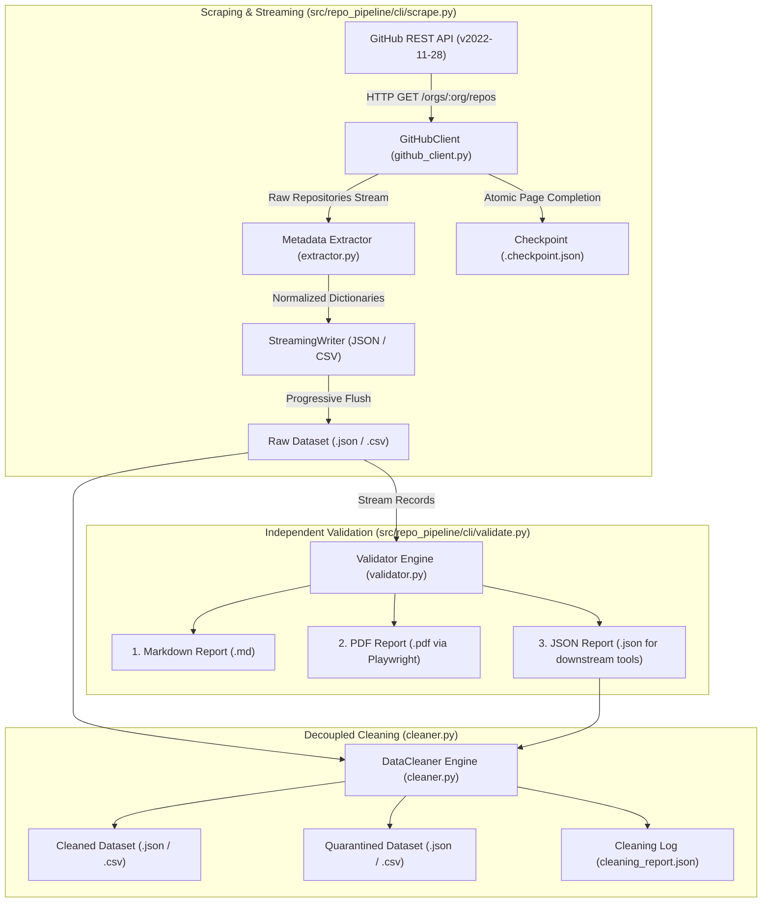

# Architecture & Design Principles

This document specifies the architectural foundation, data flow, and engineering design principles for the `repo_pipeline` repository processing platform.

---

## 1. System Architecture & Flow

---

## 2. Core Design Principles & Standards

### 1. Complete Decoupling of Validation and Cleaning
- **Validator Independence**: `validator.py` operates in strict isolation. It does not import, depend on, or modify records for any cleaner logic. Its sole objective is to inspect raw data against declarative schema definitions (`ValidationConfig` and `FieldRule`) and report all findings.
- **Consumer Independence**: `cleaner.py` acts as a downstream consumer of the validator's standard JSON report. Cleaner rules change per business requirement, but the validator contract remains invariant.

### 2. Three-Report Contract
Every complete validation run produces three synchronized deliverables:
1. **Human-Readable Markdown Report (`.md`)**: Complete overview, issue breakdown tables by severity and code, and detailed issues log.
2. **Professional PDF Report (`.pdf`)**: Styled publication document with custom typography, clean tables, and severity status badges generated via Playwright (or fallback).
3. **Machine-Readable JSON Report (`.json`)**: Structured schema including execution timestamps, summary metrics, severity distributions, and an indexable list of issues with field names, record IDs, and error codes.

### 3. Low-Memory Streaming Architecture ($O(1)$ Memory)
- Designed to run efficiently on resource-constrained environments (e.g., dual-core CPUs, 8 GB RAM).
- Uses Python generators (`Iterator[Dict[str, Any]]`) to process one repository record at a time.
- `StreamingWriter` flushes records incrementally to disk in JSON array or CSV formats, avoiding the need to hold thousands of objects in memory simultaneously.

### 4. API Resilience & Politeness
- **Respects GitHub Policies**: Sequential execution, default unauthenticated rate limit tracking (60 req/hr), and optional authenticated token support (5,000 req/hr).
- **Polite Request Pacing**: Configurable inter-request delay (`--request-delay <seconds>`) between consecutive pages.
- **Exponential Backoff with Full Jitter**: Automatically retries transient HTTP errors (429, 500, 502, 503, 504, network timeouts) using randomized exponential backoff:
  $$\text{delay} = \text{base} \times 2^{(\text{attempt} - 1)} + \text{jitter}$$
- **Rate-Limit Intelligence**: Accurately parses RFC 5988 `Link` pagination headers, GitHub's `x-ratelimit-reset` timestamps, and standard `Retry-After` delta-seconds / HTTP dates.
- **Checkpointing & Resumability**: Atomic write-and-replace checkpoint file (`<output>.checkpoint.json`) allows interrupted jobs to seamlessly resume without duplicate records or header corruption.

### 5. Special Character & Unicode Preservation
- Full UTF-8 fidelity across all data paths and serialization formats.
- Preserves accents (`café`, `naïve`), non-Latin scripts (Japanese `日本語`, Chinese `中文`, Arabic), emojis (`🚀`, `⚡`), mathematical symbols ($\sum, \int$), and raw code identifiers without mangling or unexpected escaping.

### 6. Credential Safety
- GitHub personal access tokens are **never** hardcoded.
- Credentials are dynamically resolved at runtime from CLI arguments (`--token`) or environment variables (`GITHUB_TOKEN`, `GH_TOKEN`).
- Tokens are automatically masked in logs (e.g., `ghp_...1234`).

---

## 3. Module Manifest & Responsibilities

| Path | Role | Key Responsibilities |
| :--- | :---: | :--- |
| `src/repo_pipeline/github_client.py` | API Client | HTTP transport, rate limits, `Retry-After` parsing, exponential backoff, RFC 5988 pagination. |
| `src/repo_pipeline/extractor.py` | Transformation | Schema mapping from raw GitHub API responses into flat, typed dictionaries (24 fields). |
| `src/repo_pipeline/validator.py` | Validation Engine | Type checks, regex constraints, URL validation, duplicate primary key checks, MD/PDF/JSON report generation. |
| `src/repo_pipeline/cleaner.py` | Sanitization Engine | Consumes JSON validation report; repairs fixable issues, deduplicates, and splits data into clean vs. quarantined. |
| `src/repo_pipeline/sample_data.py` | Test Dataset & Schema | Standard GitHub validation configuration and 11 deliberately corrupted test cases covering edge cases. |
| `src/repo_pipeline/cli/scrape.py` | Scraping CLI | CLI entry point (`repo-scrape`) with streaming disk writer, checkpoint/resume, signal trapping. |
| `src/repo_pipeline/cli/validate.py` | Validation CLI | CLI entry point (`repo-validate`) to execute validation, toggle checks, override rules, and optionally clean. |
| `tests/` | Unit Test Suite | 40 unit tests with mock networking covering extraction, API client, validation, and cleaning. |
